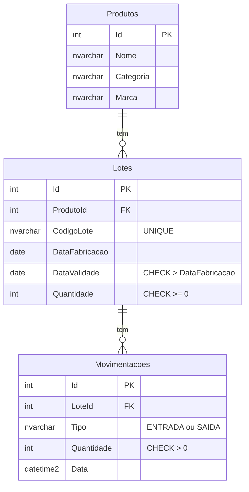
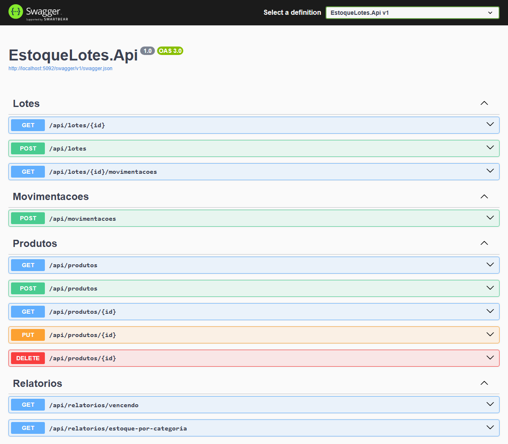

# Estoque de Lotes API

API REST para controle de estoque de **lotes de alimentos perecíveis**: cadastro de produtos e lotes,
registro de entradas e saídas, bloqueio de saída de lote vencido e histórico completo de cada lote
(rastreabilidade).

Feita em **C# / ASP.NET Core (.NET 8)** com **SQL Server** rodando em Docker, organizada em camadas
(Controller → Service → Repository) com injeção de dependência.

## O problema

Na indústria de alimentos, o estoque não é só "quantos tenho de cada produto". Cada produto é fabricado em
**lotes**, e cada lote tem a sua data de validade. É preciso saber:

- quanto há em cada lote e se ele está vencido;
- que um lote vencido **não pode sair** do estoque;
- todo o histórico de entradas e saídas de um lote, para rastrear um problema até a origem.

## Stack

| Camada | Tecnologia |
|---|---|
| API | ASP.NET Core 8 Web API (Controllers), Swagger / OpenAPI |
| Acesso a dados | Entity Framework Core 8 (CRUD) · Dapper com SQL puro (relatórios) |
| Banco | SQL Server 2022 em Docker (`docker-compose`) |
| Schema | Escrito à mão em T-SQL (`database/`), sem migrations |
| Testes | xUnit + Moq (regra de movimentação, sem banco) |
| CI | GitHub Actions: build e testes a cada push |
| Ferramentas | VS Code + C# Dev Kit, SSMS, Git |

## Modelo de dados



- As regras mais importantes também existem no banco (`CHECK`, `UNIQUE`, `FOREIGN KEY`), como última barreira
  contra dados inválidos.
- Índice em `Lotes.DataValidade` para o relatório de lotes perto do vencimento.
- `Lotes.Quantidade` é o saldo atual. Ele sempre deve ser igual a entradas − saídas do histórico, e uma consulta
  de auditoria em `database/03-consultas.sql` confere isso.

## Regras de negócio

1. A data de validade deve ser posterior à data de fabricação.
2. `ENTRADA` soma à quantidade do lote; `SAIDA` subtrai.
3. Saída maior que o estoque do lote → `400`.
4. Saída de lote vencido → `400`. Um lote é **vencido quando a validade é anterior a hoje**: no próprio dia da
   validade ele ainda pode sair. A comparação é sempre data com data (`DateOnly`), nunca com data e hora.
5. A movimentação e a atualização do saldo do lote são gravadas **na mesma transação**: ou as duas acontecem,
   ou nenhuma.
6. A quantidade inicial de um lote novo entra no histórico como uma `ENTRADA`, gravada junto com o lote.
7. Um produto que tem lotes não pode ser excluído → `400`.

## Endpoints

| Método | Rota | Descrição | Respostas |
|---|---|---|---|
| `GET` | `/api/produtos` | Lista os produtos | 200 |
| `GET` | `/api/produtos/{id}` | Busca um produto | 200, 404 |
| `POST` | `/api/produtos` | Cria um produto | 201, 400 |
| `PUT` | `/api/produtos/{id}` | Atualiza um produto | 204, 400, 404 |
| `DELETE` | `/api/produtos/{id}` | Exclui um produto (sem lotes) | 204, 400, 404 |
| `POST` | `/api/lotes` | Cria um lote (com a entrada inicial) | 201, 400 |
| `GET` | `/api/lotes/{id}` | Busca um lote, com o nome do produto e se está vencido | 200, 404 |
| `GET` | `/api/lotes/{id}/movimentacoes` | Histórico de entradas e saídas do lote | 200, 404 |
| `POST` | `/api/movimentacoes` | Registra uma entrada ou saída | 201, 400, 404 |
| `GET` | `/api/relatorios/vencendo?dias=30` | Lotes com estoque que vencem nos próximos N dias (0 a 365) | 200, 400 |
| `GET` | `/api/relatorios/estoque-por-categoria` | Estoque total e estoque válido (sem vencidos) por categoria | 200 |

Exemplo, registrando uma saída:

```http
POST /api/movimentacoes
Content-Type: application/json

{ "loteId": 3, "tipo": "Saida", "quantidade": 10 }
```

Se o lote estiver vencido, a resposta segue o padrão `ProblemDetails` (RFC 9457):

```json
{
  "title": "Regra de negócio violada",
  "status": 400,
  "detail": "O Lote 3 está vencido e não pode ser movimentado.",
  "instance": "/api/movimentacoes"
}
```

## Como rodar

Pré-requisitos: [.NET SDK 8](https://dotnet.microsoft.com/download/dotnet/8.0) e
[Docker Desktop](https://www.docker.com/products/docker-desktop/).

**1. Subir o SQL Server**

```bash
cp .env.example .env          # depois edite o .env e defina uma senha forte
docker compose up -d
```

Na primeira vez, o SQL Server leva alguns segundos para ficar pronto (`docker logs estoque-sqlserver` mostra
"SQL Server is now ready for client connections").

**2. Criar o banco e popular com dados de exemplo**

Pelo SSMS (servidor `localhost,1433`, usuário `sa`, marcar *Trust server certificate*), abra e rode, nesta ordem,
`database/01-schema.sql` e `database/02-seed.sql`. Ou pelo terminal, usando o `sqlcmd` que já vem no container:

```bash
docker exec -i estoque-sqlserver /opt/mssql-tools18/bin/sqlcmd -S localhost -U sa -P "SUA_SENHA" -C -f 65001 < database/01-schema.sql
docker exec -i estoque-sqlserver /opt/mssql-tools18/bin/sqlcmd -S localhost -U sa -P "SUA_SENHA" -C -f 65001 < database/02-seed.sql
```

O seed é idempotente: pode ser rodado de novo a qualquer momento para voltar os dados ao estado inicial.
As datas são relativas ao dia em que ele roda, então os cenários (lote vencido, lote que vence hoje, lote
zerado...) continuam válidos em qualquer dia.

**3. Configurar a connection string (fora do código, com user-secrets)**

```bash
cd src/EstoqueLotes.Api
dotnet user-secrets set "ConnectionStrings:DefaultConnection" "Server=localhost,1433;Database=EstoqueLotes;User Id=sa;Password=SUA_SENHA;TrustServerCertificate=True"
```

**4. Rodar a API**

```bash
dotnet run --project src/EstoqueLotes.Api
```

Swagger: **http://localhost:5092/swagger**

Testes (não precisam de banco): `dotnet test`



## Arquitetura

```
src/EstoqueLotes.Api/
├─ Controllers/    HTTP: recebe a requisição, chama o Service, escolhe o status code
├─ Services/       Regras de negócio; conversa com o Controller só por DTOs
├─ Repositories/   Acesso a dados (EF Core)
├─ Models/         Entidades que espelham as tabelas
├─ Dtos/           Contratos de entrada e saída da API (com validação)
├─ Data/           AppDbContext (mapeamento das tabelas existentes)
├─ Errors/         Exceções de negócio + handler global (ProblemDetails)
└─ Program.cs      Injeção de dependência e pipeline de middlewares
tests/EstoqueLotes.Tests/   Testes unitários dos Services, com mocks dos repositories
database/          Schema, seed e consultas em T-SQL
docs/DIARIO.md     Diário de desenvolvimento: o que fiz, o que aprendi e os problemas que resolvi
```

## Decisões técnicas

- **Camadas com interfaces e injeção de dependência.** O Controller não conhece o banco, e o Service depende de
  interfaces (`ILoteRepository`), não de classes concretas. Isso deixa cada parte com uma responsabilidade e
  permite testar a regra de negócio sem banco.
- **Schema escrito à mão, EF Core só mapeia.** Quis aprender modelagem e T-SQL de verdade (constraints, índice,
  transação no seed) em vez de gerar o banco pelo ORM.
- **EF Core no CRUD, Dapper nos relatórios.** O EF elimina o SQL repetitivo do CRUD. Nos relatórios, quero
  controle total da consulta, então uso SQL puro com Dapper (as mesmas consultas de `database/03-consultas.sql`)
  e parâmetros (sem concatenar strings, para evitar SQL Injection).
- **Um único "hoje".** A API decide a data de hoje (`DateTime.Today`) e a passa como parâmetro para os
  relatórios, em vez de usar `GETDATE()` no banco. O container do SQL Server tem o fuso configurado
  (`TZ` no `docker-compose.yml`) para o seed e a API concordarem sobre que dia é hoje.
- **Uma transação por movimentação.** A movimentação nova e o saldo alterado do lote são gravados num único
  `SaveChangesAsync`, que o EF Core executa numa transação.
- **Erros padronizados.** Os Services lançam exceções de negócio, e um `IExceptionHandler` global as transforma em
  `400`/`404` com `ProblemDetails`. Erros inesperados viram `500` sem expor detalhes internos.
- **Entidade × DTO.** A API nunca expõe a entidade diretamente: o contrato da API pode ficar estável mesmo se o
  banco mudar.
- **Segredos fora do repositório.** A senha fica no `.env` (Docker) e no `user-secrets` (API), e nenhum dos dois
  vai para o Git.

## Próximos passos

- [ ] Controle de concorrência nas saídas (duas saídas simultâneas do mesmo lote)
- [ ] Paginação nas listagens e autenticação com JWT
- [ ] Publicar a API e o banco na nuvem

## Como este projeto foi feito

Projeto de estudo de backend .NET. Usei IA como tutora para acelerar: ela gerou partes repetitivas (entidades,
DTOs, repositories, controllers, estrutura dos testes e CI) e explicou cada uma. O schema, o seed, as consultas
SQL, a regra de
movimentação de estoque e parte dos testes foram escritos por mim. O que aprendi em cada etapa, incluindo os
erros que cometi, está
em [docs/DIARIO.md](docs/DIARIO.md).
